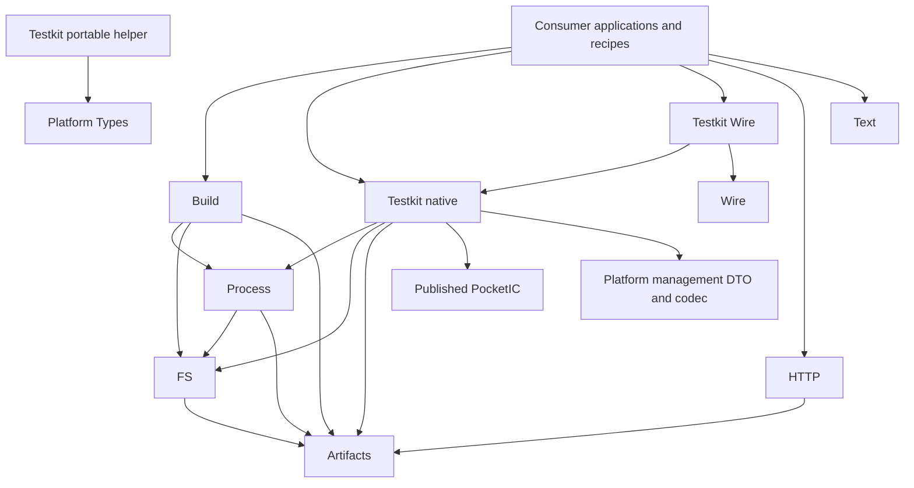

Status: implementation authorized, 15 November 2026. The first increment and remaining gates are recorded in [current status](../status/current.md). This design is for the IC Tooling maintainer and owners of its consuming repositories.

Build the replacement around the existing eight package identities and six release groups. Preserve consumer-observable behavior and public supplier type identities; reduce orchestration, redundant observations and convenience policy only where a specific replacement has been demonstrated. Use one production implementation after cutover. A greenfield repository is useful for selecting what enters the new system; it is not a reason to reimplement sound hashing, filesystem or process primitives.

The first deliverable is a vertical Foundation–Build–Scheduling slice with retained error and artifact-custody contracts. HTTP, Text and Wire should enter largely intact. The largest proposed structural change is a single product qualification roster consumed by the installed Toko runner. Do not make supplier enhancements a prerequisite for a safe launch: retain a small explicit adapter where Toko 0.43.2 does not provide the required operation.

“Hard cut” means no aliases, fallback implementations or parallel production owner in the new release. It does not mean changing Backup formats, erasing old releases, or assuming unknown public consumers do not exist.

# Evidence baseline and review scope

**Verified source facts** below come from pinned public source. **Proposed decisions** specify the replacement. **Unresolved evidence** is a release gate, not permission to delete.

The attached proposal uses commit 3aaaec1aef866aa106a2445d1394cd4c74eafe02 plus a local Platform adoption. Public main inspected for this review is **a00369fc29fa837c6deb022cceb7e09aa447292c**, committed 15 November 2026 at 08:55 UTC. It is exactly one commit ahead. The comparison changes two manifests, two locks and documentation/changelogs; it changes no product Rust source. The Platform adoption described as uncommitted in the proposal is now represented in this public commit. The handoff's historical “no commit” statements describe the earlier activity, not the current Git state. [Baseline comparison](https://github.com/dragginzgame/ic-tooling/compare/3aaaec1aef866aa106a2445d1394cd4c74eafe02...a00369fc29fa837c6deb022cceb7e09aa447292c)

Review coverage includes the recursive repository tree, all eight product manifests and crate roots, both lockfiles, production modules across all eight packages, selected failure-oriented unit and integration tests, the independent qualification workspace, release adapters/selection/receipt scripts, CI host configuration, recent commits, and sampled public sibling callers. Source retrieval and inspection are not execution qualification. No build, benchmark, archive installation or native macOS test was run in this review. This is an implementation design with explicit verification work, not a file-by-file correctness certification.

The proposal's inventory.tsv and consumer-evidence.txt were referenced but not attached. Its 46,197 physical Rust lines and 40,918 src lines remain proposal-reported measurements, not independently reproduced production LOC. They must not become a promised savings baseline.

| Package | Verified source version | Release group | Public role |
| - | - | - | - |
| ic-host-artifacts | 0.79.0 | foundation | Bounded streams, SHA-256 identities, selected gzip/Wasm |
| ic-host-fs | 0.79.0 | foundation | Descriptor reads, capability access, locks, publication, scratch custody |
| ic-host-process | 0.79.0 | foundation | Child/group execution and native observations |
| ic-build | 0.86.0 | build | Cargo execution, output capture, archive qualification, release editor |
| ic-host-http | 0.79.0 | http | Complete bounded native response bodies |
| ic-host-text | 0.76.0 | text | Terminal escaping, widths and tables |
| ic-testkit | 0.106.0 | testkit | Upstream client selection, server custody and harness helpers |
| ic-testkit-wire | 0.1.2 | testkit-wire | Native version-specific Wire call adapter |

These are manifest versions, not a fresh registry publication audit. Rust 1.100.0, edition 2024 and resolver 3 are declared. Qualification is excluded from the root workspace and has its own workspace and lock. [Product manifest](https://github.com/dragginzgame/ic-tooling/blob/a00369fc29fa837c6deb022cceb7e09aa447292c/Cargo.toml), [release groups](https://github.com/dragginzgame/ic-tooling/blob/a00369fc29fa837c6deb022cceb7e09aa447292c/ci/cargo-release-groups.json), [qualification manifest](https://github.com/dragginzgame/ic-tooling/blob/a00369fc29fa837c6deb022cceb7e09aa447292c/qualification/Cargo.toml)

Recent history matters: surface retirement was committed on 14 November; HTTP was subsequently restored for Backup; Wire qualification then added proof that a successful update can mutate state even when reply decoding refuses. These are reasons to preserve failure contracts and to avoid counting already-retired code as rewrite savings. [Surface retirement](https://github.com/dragginzgame/ic-tooling/commit/ba914e2fc4483c5256c4866402a50540a905f4e6), [HTTP restoration](https://github.com/dragginzgame/ic-tooling/commit/3b690b376b6cf58079d480230437119398742f7a), [Wire qualification](https://github.com/dragginzgame/ic-tooling/commit/0f6af5feb9cd9fe52f9e0dbb0996f9b3edd11d0c)

# Review of the supplied proposal

Accept the consumer-driven scope, Host/Build/Testkit boundaries, eight initial package identities, explicit custody, archive-based qualification and refusal to copy historical machinery. Strengthen the proposal in the following places.

| Proposal area | Finding | Design decision |
| - | - | - |
| One Build execution/decoder path | Already present: communicate_cargo feeds Host chunks to MessageDecoder | Preserve it; reduce only redundant retained representations or repeated observations with identical validity scope |
| One filesystem publication engine | Path and descriptor stream entrypoints already delegate into shared durable machinery | Preserve semantic variants; consolidation needs a concrete duplicate code path, not similar method names |
| One Wire encode/call/decode path | Already present in call_wire | Retain unchanged behavior and independent versioning |
| Remove process observation if unused | Public Profiler source directly consumes observation/procfs and child launch gates | Keep observation and its platform-specific implementation |
| Challenge standalone/baseline wrappers | StandaloneCanisterFixture is used by installed qualification; CachedPocketIcBaseline coordinates close on capture refusal | Retain initially; deletion requires replacing ownership and failure behavior, not just fields |
| Replace local release orchestration with Toko | Current scripts already invoke Toko's runner, group engine and receipt helpers | Simplify product selection/coverage data; do not create another runner or assume a future supplier API |
| Query bordered-table consumer | Current queried root manifest has no Tooling dependency and indexed search returned no ic_host matches | Treat the proposal's Query path as unconfirmed/historical; retain Text because Canic and Tooling qualification still use it |
| No compatibility aliases | Sound for the new implementation | Pair breaking removals with a version boundary, explicit supported-consumer migration and retained old registry releases |

The key risk is deleting distinctions that encode effects: a file may be visible before durability succeeds; a child may exit while descendants hold pipes; a canister update may commit before reply decoding fails; an upstream deletion attempt may return no cleanup proof. The replacement must represent all four without converting them into generic “operation failed” errors. [Build execution](https://github.com/dragginzgame/ic-tooling/blob/a00369fc29fa837c6deb022cceb7e09aa447292c/crates/ic-build/src/cargo/execution/mod.rs), [FS publication](https://github.com/dragginzgame/ic-tooling/blob/a00369fc29fa837c6deb022cceb7e09aa447292c/crates/ic-host-fs/src/durable/stream/mod.rs), [Wire implementation](https://github.com/dragginzgame/ic-tooling/blob/a00369fc29fa837c6deb022cceb7e09aa447292c/crates/ic-testkit-wire/src/lib.rs)

# Ownership and dependency architecture

The following boundaries are proposed launch requirements. They largely preserve current source ownership. A maintainer may fill more than one role, but every change must have one accountable role and one consumer acceptance owner.

| Owner role | Owns | Must not own | Required consumer reviewer |
| - | - | - | - |
| Foundation maintainer | Bytes, descriptor mechanics, locks, publication states, child custody, raw process facts | Backup formats, deployment recovery, schemas, application retries | Backup for FS; Scheduling for execution; Profiler for observations |
| Build maintainer | Cargo argv and messages, exact output selection, capture lifetime, package/archive and metadata transformations | Tool installation, simulator lifetime, release identity or product policy | Scheduling, Auth, Storage and release tooling |
| HTTP/Text maintainer | Bounded complete body reading; safe terminal rendering | HTTP request/TLS/status policy; report schema, terminal ownership | Backup; active CLI consumers |
| Testkit maintainer | Server admission/custody, instance composition, snapshot/install/progression helpers | PocketIC transport fork, portable runtime, global runtime lock | DB and Platform qualification owners |
| Wire adapter maintainer | One encode/call/decode operation with caller identity and budgets | Endpoint registry, authorization, retries, server lifetime | Installed Wire probe owner |
| Release maintainer | Product roster, source identity, release group policy, final evidence admission | Fork of Toko mechanics | All changed groups and affected consumer owners |
| Toko supplier | Generic runner, release transaction and evidence mechanics supplied by its selected release | Tooling product invariants or sibling acceptance | Release maintainer |

Dependency direction remains acyclic:



Text has no internal production dependency. Build does not depend on Testkit or Platform. Testkit does not depend on Build. Private qualification composes these owners and selects Runtime for its Wasm probe. Native simulator Principal belongs to upstream PocketIC; portable Principal belongs to Platform Types. Convert at the boundary when necessary; do not introduce another Principal wrapper. The upstream PocketIC and Reqwest reexports deliberately preserve supplier identity and are not retired-API compatibility aliases. [Current extraction contract](https://github.com/dragginzgame/ic-tooling/blob/a00369fc29fa837c6deb022cceb7e09aa447292c/docs/extraction.md), [Testkit root](https://github.com/dragginzgame/ic-tooling/blob/a00369fc29fa837c6deb022cceb7e09aa447292c/crates/ic-testkit/src/lib.rs)

Keep the existing top-level layout: eight crates, independent qualification, ci product data, thin scripts, and release ledgers. Do not introduce a universal Host facade, plugin registry, generic lifecycle coordinator, service container, new cache subsystem or shared test framework. Private helpers belong next to their owning operation.

Every proposed abstraction must name the duplicated mechanism it removes, the effect boundary it preserves, and a consumer that benefits. “Fewer files” and “more uniform APIs” are insufficient reasons.

# Consumer contract register

The following is the initial verified register, not a claim that every public user has been found. Manifest requirements are ranges as written, not resolved lock versions. Search-only observations are marked separately from inspected full implementations.

| Contract | Public evidence | Required behavior | Migration and acceptance |
| - | - | - | - |
| C01 Backup payload | Full payload implementation at ec681f2; Artifacts/FS 0.79.0, capability; HTTP 0.79.0 with rustls in root manifest | hash_exact_reader, ArtifactIdentity and Sha256Digest; held Directory traversal, FileIdentity, bounded reads; original causes | Preserve format and hash bytes. Run payload integrity, root rename, child replacement, growth/short read and restore-precondition cases in Backup |
| C02 Scheduling build | Full build module at b1a1258; qualification selects Build 0.86.0, Foundation 0.79.0, Testkit 0.105.0 | CargoInvocation/ExecutionPolicy, exact Wasm selection, CapturedArtifact, configuration identity, target lock and durable report publication | Compile the actual qualification workspace, then run watchdog/runtime cases using replacement archives; compare recorded artifact hashes and input-drift refusal |
| C03 Canic host | Full store.rs and artifact.rs at f6b5c37; FS/Process 0.79.0, Text 0.76.0 | CreateNew private records, no-follow reads, lock lifetime, bounded group capture, safe tables | Keep existing persisted records readable; exercise occupied record, concurrent lock, nonzero child and output ceiling. Its own Cargo parser remains consumer-owned unless separately migrated to Build |
| C04 Auth tooling | Source import search at e52a40b; Build 0.86.0 and FS 0.79.0 manifest | verify_external_lock_subset, read_file_no_follow, write_with | Compile tooling binary and run external-lock/client-contract refusals; inspect complete callers before changing signatures |
| C05 Storage repo tool | Source search at d2762f2; Build 0.84.0, Foundation 0.77.0 manifest | CargoMetadataSpec, decode_metadata, capture_command and artifact identity | First qualify the old-to-current transition, then the rewrite. Do not infer compatibility across 0.x minor lines |
| C06 DB rollback driver | Source search at 62963f7 | PocketIcInstance, PocketIcStartupConfig, server_assets, upstream PocketIcBuilder | Run real rollback tests with raw stable-byte oracle; preserve external-server ownership and explicit setup |
| C07 Profiler | Full host adapter at e4c165b; launch-gate source search | ProcessObservation fields, clocks, process identity, procfs child discovery and OwnedChild/gated_command | Keep Linux and macOS facts; run process identity/reuse and launch-gate tests on each native host |
| C08 Toko release caller | Tooling's installed adapter and current supplier script | Release editor argv, candidate bytes, exit behavior and no in-place source edits | Test against the installed supplier snapshot, not only supplier main; update producer/consumer together if protocol changes |
| C09 Tooling qualification | Full public_contracts and canister_wire tests | Exact supplier types, StandaloneCanisterFixture, raw and typed Wire calls, committed update effects | Preserve installed probe and type checks using packaged dependencies |
| C10 Platform and Query | Proposal plus limited public search/manifest evidence | Platform client/runtime composition; Query table usage is not currently established | Reconcile actual fixtures, aliases and selected revisions before retiring any claimed capability |

Primary consumer references: [Backup payload](https://github.com/dragginzgame/ic-backup/blob/ec681f21506db0482b2cf3843f44593c56347994/crates/ic-backup/src/store/payload/mod.rs), [Backup manifest](https://github.com/dragginzgame/ic-backup/blob/ec681f21506db0482b2cf3843f44593c56347994/Cargo.toml), [Scheduling build](https://github.com/dragginzgame/ic-scheduling/blob/b1a1258ead537ee6b76f71c3bd5f5df3e23e4225/qualification/ic-timers-pocketic/src/build/mod.rs), [Scheduling selections](https://github.com/dragginzgame/ic-scheduling/blob/b1a1258ead537ee6b76f71c3bd5f5df3e23e4225/qualification/Cargo.toml), [Canic store](https://github.com/dragginzgame/canic/blob/f6b5c37ead9f443f49d1d7cac0b0897f56d221e7/crates/canic-host/src/store.rs), [Canic build](https://github.com/dragginzgame/canic/blob/f6b5c37ead9f443f49d1d7cac0b0897f56d221e7/crates/canic-host/src/artifact.rs), [Auth caller](https://github.com/dragginzgame/ic-auth/blob/e52a40be75dd9809d0528189d84b43fe96952ad9/crates/ic-auth-tooling/src/main.rs), [Storage caller](https://github.com/dragginzgame/ic-storage/blob/d2762f2dc7db339a88446e9c7c620ab95785711b/crates/ic-storage/tools/repo_tool/processes/mod.rs), [DB driver](https://github.com/dragginzgame/ic-db/blob/62963f78e9b8e28fc161f41435f83114aaca3123/qualification/rollback-driver/src/lib.rs), [Profiler adapter](https://github.com/dragginzgame/ic-profiler/blob/e4c165b28c4450bfd4fbda6dbc3f9c513b313753/profiler/system/src/host.rs).

Before a public removal, expand each row to exact symbol/reexport, feature, target, caller revision, manifest requirement, resolved supplier identity, success behavior, error/effect behavior, replacement, test command and evidence receipt. Generate exports per supported feature/target; a text search alone misses aliases, macros, examples and scripts. Default disposition for an unresolved current export is **retain**. This permits implementation to start without pretending the retirement inventory is complete.

Maintainer intent is still needed for launch workloads, especially Canic, but observed current callers must be treated as supported until explicitly excluded. Unknown external consumers keep their old releases; the new incompatible line must have a complete removal/migration ledger.

# Concrete API and effect contracts

## Artifacts

Retain the existing APIs and error identity for C01/C02:

```rust
pub fn hash_reader(reader: impl Read, max_bytes: u64)
    -> Result<ArtifactIdentity, ArtifactError>;

pub fn hash_exact_reader(reader: impl Read, expected_bytes: u64)
    -> Result<ArtifactIdentity, ArtifactError>;

pub struct ArtifactIdentity {
    pub bytes: u64,
    pub sha256: Sha256Digest,
}
```

These are existing signatures to preserve, not newly implemented code. Hash original bytes without text normalization, decompression or serialization round-trips. Exact-length admission rejects both early EOF and growth; at most one additional byte may be read to detect overflow. Only interrupted I/O is retried. A digest is content identity, not authenticated origin or proof that a file will remain unchanged.

Keep bounded read/copy/visitor/writer operations where independent callers need them. A write failure may leave bytes in a caller-provided sink; it is not a transaction. Allocation refusal remains distinguishable from byte-limit and I/O failure. gzip limits must distinguish encoded input and decoded output; no gzip bomb may bypass the decoded ceiling. Keep structural Wasm inspection, full validation and text compilation separately selected. Do not label header/structure inspection as semantic validation. [Artifacts implementation](https://github.com/dragginzgame/ic-tooling/blob/a00369fc29fa837c6deb022cceb7e09aa447292c/crates/ic-host-artifacts/src/artifact/mod.rs), [feature definitions](https://github.com/dragginzgame/ic-tooling/blob/a00369fc29fa837c6deb022cceb7e09aa447292c/crates/ic-host-artifacts/Cargo.toml)

## Filesystem

Retain the current publication API:

```rust
pub enum PublicationMode { Replace, CreateNew }
pub struct WriteOptions {
    pub mode: PublicationMode,
    pub permissions: u32,
}

pub fn write_with<T, E>(
    path: &Path,
    options: WriteOptions,
    produce: impl FnOnce(&mut File) -> Result<T, E>,
) -> Result<T, NamedWriteError<E>>;
```

Also retain write_at_validated_with for a held parent descriptor and a single admitted name, write_validated_with for executable/read-only staging admission, retained staging, verified-copy/non-aliasing export and directory commit until their distinct consumers are migrated.

The internal state machine is: validate inputs → admit/hold parent → create exclusive sibling stage → produce → sync file → perform required validation/identity checks → publish → sync parent → release staging custody. Each effectful transition has a fault-injection point. CreateNew must refuse the final race, not merely check absence before writing. Replace must not follow the destination's final symlink. Descriptor-relative operations keep meaning through parent renames and must not silently reopen the original pathname.

| Returned state | Guaranteed meaning | Caller action |
| - | - | - |
| Producer | Producer/admission refused; publication not attempted; original E and independent cleanup error retained | Preserve cause; inspect any retained owned staging |
| BeforePublication | This operation has not published the destination; failure may still have created parents/staging | Retry only under caller policy after reconciling retained effects |
| AfterPublication | New output is visible; final cleanup or directory durability is not established | Inspect identity and reconcile; never blindly replay CreateNew |
| Success | Required file and parent synchronization completed | Consume under the caller's continued custody assumptions |

Keep NamedWriteError's existing variants and payloads initially. Do not add a generic transaction abstraction across files. Directory commit, in-place sync and exported non-aliasing copies have different effects and remain distinct operations. “No-follow final component” must not be documented as whole-tree confinement. Locks require held descriptors and explicit shared/exclusive lifetime; path canonicalization is not an adequate replacement. Drops are best effort; explicit close/cleanup APIs report failures. Never delete a foreign entry that replaced owned staging. [Publication errors](https://github.com/dragginzgame/ic-tooling/blob/a00369fc29fa837c6deb022cceb7e09aa447292c/crates/ic-host-fs/src/durable/named/mod.rs), [descriptor tests](https://github.com/dragginzgame/ic-tooling/blob/a00369fc29fa837c6deb022cceb7e09aa447292c/crates/ic-host-fs/src/durable/stream/tests/mod.rs)

## Process

Preserve OwnedChild, CleanupPolicy, CompletedExecution, ToolError, OutputLimits and the distinction between OutputLimit::Terminate and OutputLimit::Truncate. Retain spawn_direct versus group spawn: direct-child ownership grants no authority over descendants, while a group is the explicitly selected cleanup scope.

One communication engine owns input writes, simultaneous stdout/stderr draining, cancellation, deadlines, output accounting and cleanup. Build and Testkit compose it. Frame parsing remains a separate bounded byte-to-record function; consumers own JSON/schema interpretation and whether an EOF tail is valid.

Required lifecycle states are owned/running, leader-exited-but-still-owned, draining, cleanup-attempted, reaped, and explicitly handed off/relinquished as supported by current APIs. Do not treat leader exit as pipe EOF or successful handoff. Observer failure and cancellation preserve captured evidence and cleanup failures. Truncation limits retained bytes while continuing drain; complete-output consumers must call require_complete in addition to require_success. Neither a byte ceiling nor a timeout implies a bound on every OS cleanup operation.

Keep process observation as a separate module within Process, not a separate public crate for launch. Raw procfs/libproc/Mach facts stay here; Profiler owns sampling cadence, selected roots, aggregation and serialized reports. Preserve PID/start identity distinctions and “unavailable” versus zero values. [Process owner](https://github.com/dragginzgame/ic-tooling/blob/a00369fc29fa837c6deb022cceb7e09aa447292c/crates/ic-host-process/src/child/mod.rs), [communication API](https://github.com/dragginzgame/ic-tooling/blob/a00369fc29fa837c6deb022cceb7e09aa447292c/crates/ic-host-process/src/tool/mod.rs)

## Build

Keep CargoInvocation as the sole rendered recipe and execute_cargo as its observed execution entrypoint. Its current result deliberately separates execution, messages and facts. Admission order is: process success, complete required output, protocol completion, valid execution facts, exact artifact selection, bounded capture, then consumer validation/publication. Do not turn an exit-zero result or a filesystem path into an admitted artifact.

The invocation includes executable, absolute cwd, a complete child environment, explicit RUSTC, target, selection/profile/features, packages, manifest, recipe and ordered configurations. Environment values must not be dumped into generic Debug/log output. The current command builder clears inherited environment. Spawner mutation invalidates facts; tool identity observations before/after execution remain until an equally strong immutable-tool custody contract replaces them.

Current successful observed execution performs Cargo and rustc identity probes both before and after the main build. These are four probes plus the build, not automatically five redundant “builds.” Measure before optimizing. Version output is an observation, not a cryptographic executable identity or source-custody proof.

Retain select_cdylib_wasm(messages, manifest, recipe): require successful completion and exactly one distinct output for the exact manifest and library/named-example recipe. No filename convention or stale target-directory fallback. Capture while the caller holds the appropriate target/build lock; maintain CapturedArtifact through every use. An owned path does not make its contents immutable against noncooperating writers.

Proposed internal reduction: collect canonical Cargo events once into a bounded selection accumulator containing completion state, relevant output candidates and required build-script facts. Keep callbacks streaming. Do not retain all messages merely for selection. Bound the number and total path bytes of candidates before insertion. This is private implementation work; current public callback and selection contracts can remain. Release/package admission still performs fresh observations at different mutation boundaries—those observations are not reusable merely because their schemas match.

Archive qualification and external-lock verification stay separate from application builds. A workspace success does not prove the packaged consumer graph. Preserve release metadata rendering in Build until an actual supplier transfer is completed. [Invocation and facts](https://github.com/dragginzgame/ic-tooling/blob/a00369fc29fa837c6deb022cceb7e09aa447292c/crates/ic-build/src/cargo/execution/invocation.rs), [selection](https://github.com/dragginzgame/ic-tooling/blob/a00369fc29fa837c6deb022cceb7e09aa447292c/crates/ic-build/src/cargo/execution/mod.rs), [capture custody](https://github.com/dragginzgame/ic-tooling/blob/a00369fc29fa837c6deb022cceb7e09aa447292c/crates/ic-build/src/artifacts/staging/mod.rs), [archive qualifier](https://github.com/dragginzgame/ic-tooling/blob/a00369fc29fa837c6deb022cceb7e09aa447292c/crates/ic-build/src/cargo/packages/archive/mod.rs)

## HTTP and Text

Preserve the existing native HTTP signature:

```rust
pub async fn read_body(
    response: reqwest::Response,
    max_bytes: usize,
) -> Result<Vec<u8>, ReadError>;
```

Refuse oversized declared length before reading, then enforce the streamed ceiling even when length is absent or misleading. Return only a complete body; no error carries partial bytes. Preserve typed transport/allocation causes and redacted Display. The ceiling covers bytes yielded by Reqwest, not all network/chunk/decompression allocation. Caller owns status, origin, TLS, redirects, deadlines, cancellation and retries; cancelling does not prove a request had no effect. Keep the exact selected Reqwest type reexport and opt-in rustls. [HTTP body reader](https://github.com/dragginzgame/ic-tooling/blob/a00369fc29fa837c6deb022cceb7e09aa447292c/crates/ic-host-http/src/response/mod.rs)

Retain terminal_text, width functions, table::render and table::render_bordered. Preserve escaping before measurement, Unicode scalar-width behavior, zero-column behavior and no final newline. Preserve missing/extra cell behavior in dynamic bordered tables. These APIs do not promise grapheme/terminal-dependent emoji width or fallible allocation. Callers own row/input/output budgets. Adding a formatting framework or changing table output is outside this rewrite. [Table implementation](https://github.com/dragginzgame/ic-tooling/blob/a00369fc29fa837c6deb022cceb7e09aa447292c/crates/ic-host-text/src/table/mod.rs)

## Testkit and Wire

Retain native ic_testkit::pocket_ic as the unchanged upstream crate identity; fake_principal remains portable and must produce the same bytes for the same u32 seed. Native startup uses the caller's runtime and prepared server assets. check never downloads; setup remains explicit. A managed owner may stop its own server; an external-server attachment must never acquire that authority.

PocketIcInstance::close consumes the owner and awaits upstream instance deletion before releasing the managed server. Its current unit return is not proof that remote deletion succeeded: upstream deletion is best effort. Do not invent a typed “remote cleanup confirmed” result without supplier support. Keep instance_mut and into_parts obligations explicit. No blocking runtime wrapper, process-wide singleton or alternate transport.

Snapshots preserve capture sender, deterministic ordering, duplicate refusal before effects, known-snapshot cleanup rejection evidence and caller-selected restore funding. Partial capture/restore and cancellation require reconciliation. Stop/drain, time, progress, restart and cycle policy stay with the caller. Keep the existing 2 MiB message/1 MiB data-window implementation distinction; these are not total-snapshot or upstream-transport memory bounds. [Startup ownership](https://github.com/dragginzgame/ic-tooling/blob/a00369fc29fa837c6deb022cceb7e09aa447292c/crates/ic-testkit/src/pic/startup/mod.rs), [snapshot contracts](https://github.com/dragginzgame/ic-tooling/blob/a00369fc29fa837c6deb022cceb7e09aa447292c/crates/ic-testkit/src/pic/snapshot/mod.rs)

Retain WireCallSpec { method, method_id, request_limits, response_limits }, query_wire and update_wire. Request encoding occurs once before transport; one call follows; response decoding occurs once. Keep borrowed Serialize requests and owned DeserializeOwned responses, caller-selected principal, exact method name and Wire identity. Preserve Encode/Call/Decode causes, context and byte counts. Transport panics remain upstream behavior; raw reply bytes are not retained. Request/response Wire budgets cannot bound the already allocated upstream reply buffer. Decode refusal after update grants no retry authority. Application results pass through unchanged. [Wire API](https://github.com/dragginzgame/ic-tooling/blob/a00369fc29fa837c6deb022cceb7e09aa447292c/crates/ic-testkit-wire/src/lib.rs)

# Dependencies and compatibility policy

Keep dependency selection separate from resolved identity. The public root manifest requests Platform 0.33.6, Types 0.20.4, PocketIC 16.1.0, Reqwest 0.13.5 and Wire 0.22.0. Both inspected locks resolve Wire 0.22.2, Platform 0.33.6, Types 0.20.4 and PocketIC 16.1.0; qualification additionally resolves Runtime 0.22.5. Toko is exactly pinned at 0.43.2 and its snapshot records the registry checksum. These statements describe the inspected checkout, not all downstream resolutions. [Product lock](https://github.com/dragginzgame/ic-tooling/blob/a00369fc29fa837c6deb022cceb7e09aa447292c/Cargo.lock), [qualification lock](https://github.com/dragginzgame/ic-tooling/blob/a00369fc29fa837c6deb022cceb7e09aa447292c/qualification/Cargo.lock), [Toko snapshot](https://github.com/dragginzgame/ic-tooling/blob/a00369fc29fa837c6deb022cceb7e09aa447292c/.toko-tooling.snapshot)

| Dependency boundary | Launch policy |
| - | - |
| cap-std/cap-fs-ext and rustix | Retain descriptor-based semantics; keep capability optional and target-specific. Do not replace with pathname checks |
| sha2 | Retain upstream SHA-256; no handwritten cryptography |
| wasmparser, wat, wasm-encoder | Keep validation/text/fixture generation optional; upgrade matching format families together and rerun malformed-module fixtures |
| cargo_metadata, toml/toml_edit | Keep canonical Cargo messages and structured metadata edits; no competing regex parser |
| Reqwest | Keep native-only selection and reexport; TLS opt-in; no HTTP policy added |
| PocketIC | Keep published upstream client; native only; qualify its actual panic/deletion behavior |
| Platform Types | One public portable Principal owner |
| Platform management DTO/codec | Native snapshot adaptation only; no Runtime dependency in Testkit |
| Runtime and guard | Private Wasm probe only; exactly one selected owner for runtime/guard/system API |
| Wire and Serde | Adapter only; preserve matching Wire-generation limits/errors and native-only dependency edge |
| Toko | Pin/admit supplier payload; product adapters consume supported entrypoints without editing vendor internals |

Preserve default-empty optional-feature selections and existing target guards. Validate minimal, individual-feature and all-feature profiles in isolated consumer workspaces; all-features alone hides accidental feature unification. Text may stay independently released; HTTP must not be folded into FS or Testkit. Testkit Wire stays independently versioned because its public Wire identity can change independently of lifecycle policy.

**Compatibility rule:** keep existing names/signatures/error variants for retained launch capabilities unless a concrete simplification requires a change and every supported caller has a paired migration. Do not add compatibility aliases or restore removed fork APIs. A patch release may not remove a public item, change required features, reinterpret limits, change persisted bytes, erase error evidence or silently change cleanup authority.

For incompatible 0.x public changes, choose a new minor line for the affected release group; do not reuse or overwrite any published version. Foundation changes remain coordinated across its three members. Independent groups advance only when their own contract or dependency admission changes. The implementation must select available versions at release time; this document does not reserve version numbers.

Treat crate names, import paths, public supplier types, Cargo features, supported targets/MSRV, CLI flags/env, stdout framing, exit classification and persisted consumer bytes as distinct contracts. Source compatibility is insufficient if a caller's recovery branch changes meaning.

During development, isolated path-patched consumer workspaces may compare old and new builds. Launch qualification must use registry-style package archives without hidden path overrides. The final supported cohort must use compatible supplier identities where public values cross package boundaries. Do not force all transitive dependencies to a single version indiscriminately.

Old published versions remain immutable historical artifacts. No promise is made here to maintain old lines indefinitely, and no remote archive, repository or release is deleted. Unknown public users receive a versioned migration document; they are not silently switched. Backup manifests, payload bytes, Canic operation records and application Wire schemas remain owned and versioned by their consumers.

# Deletion and retention ledger

Every deletion entry must include an old path/symbol, caller disposition, replacement, protected invariant and passing acceptance evidence. There are three classes: prohibited resurrection, conditional removal, and retained implementation. They must not be combined in a savings figure.

| Item | Decision for the new tree | Replacement or exit criterion |
| - | - | - |
| Retired Host Tools, allocator crate, old PocketIC fork/transport, pools, renderer diagnostics and obsolete aliases | Do not import | Already-retired capabilities are not new savings; retain provenance references only |
| Existing hash/FS/process safety primitives | Selectively transplant with provenance and tests | Simplify only after a specific duplicate mechanism is identified |
| Process observation/procfs/macOS mechanics | Retain | Profiler is an observed consumer; retirement requires a separate owner transfer |
| HTTP, Text and Wire implementation | Retain substantially intact | Small, independently justified surfaces; retain their contract tests |
| StandaloneCanisterFixture | Retain for launch | Internal installed callers exist. A later removal may replace it with a local fixture containing PocketIcInstance plus CanisterId, with identical unwind/ownership tests |
| CachedPocketIcBaseline | Retain until complete caller review | Free snapshot functions plus an explicitly owned instance/metadata fixture must preserve capture-failure close, funding, senders and cancellation obligations |
| Build full-message buffering used only for selection | Conditional removal | Private bounded accumulator; retain canonical streaming callbacks and required diagnostic evidence |
| Repeated metadata/tool observation | Conditional removal, scoped per operation | Reuse only within identical admitted input and mutation boundaries; keep checks before/after mutation |
| Archive qualification/external-lock evaluator | Retain | Auth and installed-package contracts need behavior workspace builds cannot prove |
| Build release metadata editor | Retain at current boundary | Transfer only after installed Toko consumes a qualified replacement; no premature second editor |
| Local generic release execution/journal logic duplicated by installed Toko | Conditional removal | Prove the supplier operation covers the exact success/refusal/resume protocol |
| Separate manually maintained stage-selection/coverage maps | Replace with one product roster where feasible | Derive views; validate one source of stage identity and complete reverse-consumer closure |
| Repeated test scaffolding | Consolidate locally | Share setup only; retain independent assertions and failure injection |
| Old source checkout, receipts, target evidence, history and published identities | Preserve outside replacement build graph | No implicit cleanup or destructive storage migration |

The safe launch default is deliberately conservative for low-value public wrapper removals. A hard cut can replace internal architecture while keeping useful API names. Renaming every type adds migration work without reducing mechanisms.

A production deletion is rejected if its rationale is merely “no lexical hits,” “many lines,” or “similar tests.” It is accepted when the behavior is retired by the owning workload decision or the replacement proves the same preconditions, effects, refusal and cleanup evidence. Test removal requires the same comparison, including the independent fault being injected.

# Release architecture and command contracts

## One product roster

The installed Toko runner is the execution authority. Tooling supplies product tasks, affected-group/reverse-consumer coverage, required hosts and admissible evidence inputs. Toko's generic mechanics remain a pinned supplier payload, not newly maintained Tooling source.

Current validation.sh already calls run-validation-targets.sh; adapter.sh invokes the group/receipt machinery; validation-roster.sh checks product coverage against the stage roster. The opportunity is reducing product-specific selection/proof duplication, not replacing the existing shared runner with a new one. Preserve current adapters until replacement coverage is demonstrated. [Validation entrypoint](https://github.com/dragginzgame/ic-tooling/blob/a00369fc29fa837c6deb022cceb7e09aa447292c/scripts/release/validation.sh), [release adapter](https://github.com/dragginzgame/ic-tooling/blob/a00369fc29fa837c6deb022cceb7e09aa447292c/scripts/release/adapter.sh), [coverage roster](https://github.com/dragginzgame/ic-tooling/blob/a00369fc29fa837c6deb022cceb7e09aa447292c/scripts/ci/validation-roster.sh)

Proposed product record, expressed as an internal data contract rather than a claimed existing Toko schema:

```json
{
  "schema": 1,
  "id": "build-cargo-contract",
  "owner": "build",
  "affected_groups": ["foundation", "build"],
  "requires": ["prepared-rust"],
  "targets": ["x86_64-unknown-linux-gnu", "x86_64-apple-darwin", "aarch64-apple-darwin"],
  "command": ["cargo", "test", "-p", "ic-build", "--features", "test-support", "--test", "cargo_execution", "--locked", "--offline"],
  "inputs": ["Cargo.lock", "crates/ic-build", "crates/ic-host-process", "crates/ic-host-fs", "crates/ic-host-artifacts"]
}
```

This is an illustrative row, not a complete release plan. Keep argv as an array, stable IDs unique, dependency edges acyclic and input coverage closed over shared fixtures and runner code. Generate the supplier-supported roster format at the adapter boundary; validate it before execution. Do not invent a supplier extension and then assume it exists.

For launch, use full validation on every required native host. Focused validation is an optimization admitted only after matched full/focused comparisons on all three hosts. A previously passing Linux full gate does not establish focused equivalence or macOS coverage. Shared scripts, manifest/lock policy changes, unknown paths, graph changes and unclassified changes select full validation.

Proposed future focused closure: Foundation includes Build/HTTP/Testkit/Wire; Build includes package/editor and its consumer fixtures; Testkit includes Wire and native/portable graph checks; Wire includes its installed probe; Text includes real CLI/golden output; HTTP includes body/TLS consumer contracts. Code dependencies alone do not define this closure—CLI and release protocol edges count.

Evidence identity must bind source commit plus any admitted source inventory, both lockfiles, feature/target/profile selections, compiler/tools/server identities, runner/roster versions, exact argv, relevant environment policy, artifact digests and host OS/architecture. Store exit status and logger status separately. Secret values must be excluded or represented through an approved non-reversible/context identity mechanism; a redacted string alone is not proof of equivalent secret-dependent execution.

A cached result is reusable only for the same declared proof and inputs. Test-binary reuse and validation-proof reuse are different decisions. Incomplete, missing, stale, changed-host or changed-runner receipts refuse. Resume uses the recorded plan and re-admits inputs; it never converts a skipped stage into a successful result.

## Release editor protocol

Preserve the current executable name and operations:

```text
ic-build-release-metadata --max-input-bytes N group-manifest SOURCE PREVIOUS NEXT SELECTION_JSON
ic-build-release-metadata --max-input-bytes N manifest SOURCE PREVIOUS NEXT [WORKSPACE_INPUT_JSON]
ic-build-release-metadata --max-input-bytes N lock SOURCE PREVIOUS NEXT PACKAGE...
```

N is positive and applies per input document. Success writes candidate bytes to stdout; it does not install them into SOURCE. The group selection has version = workspace, package or unchanged, and explicit dependency alias/previous/next entries. Unknown fields and malformed input refuse according to the current parser. Preserve formatting/comments to the degree the existing renderer and golden tests guarantee; do not promise arbitrary textual identity.

Candidate construction finishes before stdout emission. An output I/O failure can still leave partial stdout, so the caller must require a successful exit before accepting redirected bytes. Diagnostic stderr must never be parsed as candidate content. The current main returns exit 0 on success and exit 2 for rendering/read refusal or unsupported non-Unix execution; preserve parser help/version behavior separately through black-box tests. The generic transaction owner validates and installs the admitted candidate; Build does not choose the release version or publish it. [Editor implementation](https://github.com/dragginzgame/ic-tooling/blob/a00369fc29fa837c6deb022cceb7e09aa447292c/crates/ic-build/src/bin/release_metadata_cli/mod.rs), [CLI tests](https://github.com/dragginzgame/ic-tooling/blob/a00369fc29fa837c6deb022cceb7e09aa447292c/crates/ic-build/tests/release_metadata_cli.rs)

Retain ic-host-file and ic-testkit-server CLI contracts too. Inventory their exact help/argv/env/stdout/exit behavior and include script consumers; no deletion is authorized merely because the binaries are feature-gated.

## Bootstrap and publication

Avoid a self-hosting cycle: the release editor used to prepare the first replacement release must be an already admitted released executable, selected by explicit identity. Building the replacement editor is a separate candidate qualification task. Upgrade the release tool only after verifying its producer archive and protocol against the installed Toko snapshot.

Prepare tools/server assets explicitly, then freeze source and execute offline qualification. Publish groups in dependency order: Foundation; Build and HTTP as needed; Text independently; Testkit; Wire. Choose exact downstream requirements only after their supplier archives are admitted. A successful upload is not completion: read back each registry archive and verify checksum, manifest, VCS identity and intended package/version before advancing dependent publication.

Publication is not atomic across packages. If it stops mid-cohort, record exactly which versions exist, halt consumer cutover, retain receipts and finish or supersede with new versions. Never republish a version with different bytes. Existing consumers remain on their prior cohort until the complete replacement cohort is admitted.

# Migration sequence

Each phase ends in reviewable code, a contract diff and evidence. The sequence is mandatory; work inside independent packages may be scheduled separately, but no phase inherits unearned acceptance from another.

| Phase | Work and owner | Exit gate |
| - | - | - |
| M0 Contract freeze | Release maintainer freezes Tooling and each supported consumer revision, exports/features/targets/CLI inventory, release identities, baseline commands and invariants | G0 inventory closed for every planned removal; unresolved exports retained |
| M1 Replacement scaffold | Foundation/Build maintainers create clean workspace layout, package boundaries, explicit features, private qualification and admitted Toko payload; no publishing configured | G1 graph/MSRV checks and provenance inventory |
| M2 Foundation vertical slice | Artifacts → FS → Process; preserve public contracts and fault injection; patch isolated Backup/Scheduling/Profiler consumers | G2 byte/custody/process invariants plus actual consumer compile and targeted behavior |
| M3 Build slice | Retain canonical executor, introduce only measured private reductions, retain archive/editor contracts; migrate Scheduling/Auth/Storage fixtures | G3 build/output/capture/archive/editor acceptance |
| M4 Small owners and simulator | Bring HTTP/Text intact; qualify Testkit ownership/snapshots, then Wire; retain wrappers with active callers | G4 native installed behavior and portable graph |
| M5 Qualification consolidation | Replace duplicated local roster data with one product definition; execute through selected Toko; retain adapters where required | G5 complete plan/evidence/failure/resume tests; no narrowed release gates yet |
| M6 Candidate archives | Package all changed groups; test isolated consumers using archives with no local path leakage | G6 archive provenance, type identity and supported-consumer acceptance |
| M7 Canonical cutover | Release owner transfers publication authority to exactly one canonical checkout, publishes ordered cohort and validates registry readback | G7 three-host release gate and complete delivery receipts |
| M8 Consumer cutover and retirement | Consumer owners land coordinated dependency/API changes, run full consumer suites, remove temporary comparisons and old production paths | G8 launch checklist complete; old source/evidence retained for diagnosis |

Use a local unpublished replacement during M1–M6. Comparison binaries belong only to validation and must have an explicit removal phase. Do not install both implementations into a production runtime or select one through a fallback flag.

Do not equate a new Git repository with a new package authority. Prefer keeping the existing canonical remote and package identities, introducing the rewritten tree through a reviewable change with provenance. If a separate canonical repository is required, decide ownership, metadata, license/provenance retention, registry maintainers and release credentials before M7; only one destination may publish the existing crate names.

Before publication, rollback means abandoning the candidate and continuing the old cohort. After publication, registry versions remain; rollback means restoring consumer pins/deployments to the previous qualified cohort if their formats/state remain compatible. Because this design changes no persisted formats, this is the intended rollback path, but it must be exercised in the consumer. It cannot undo external effects, delivered messages or partially completed publications.

# Validation and acceptance gates

These are required tests for the replacement. The named current tests are source evidence of useful assertions, not claims of a passing run in this review.

| Gate | Required evidence | Pass condition |
| - | - | - |
| G0 Contract completeness | Export/feature/target/CLI diff; supported consumer revisions; removal ledger | Every removal has an owner, replacement/retirement decision and acceptance test; no unresolved deletion |
| G1 Architecture | Isolated default/minimal/feature graphs, native and Wasm checks, MSRV, lint, docs | No upward Host/Build dependencies; native Testkit has no Runtime; portable Testkit has no native stack; one required supplier identity at public boundaries |
| G2 Foundation | Unit, property/parser boundary, injected failure and real OS tests | Exact bytes/lengths; original error causes; publication phase truth; safe retained custody; fair drain/cancellation and correct cleanup scope |
| G3 Build | Real Cargo fixtures, mutated inputs, malformed protocol, competing outputs, capture lifetime and editor/package tests | No admission from failed/incomplete execution, stale or ambiguous output; packaged graph and editor candidates independently validated |
| G4 Simulator and Wire | Admitted server, real canister install/snapshot/restore, caller identity and malformed Wire cases | External server never killed; original cleanup evidence retained; state restoration proven; decode refusal after update causes exactly one mutation and no retry |
| G5 Release mechanics | Changed-path selection, unknown-path fallback, stale receipt, logger failure, stage failure and interrupted/resumed run | Complete deterministic plan; failed/skipped stage cannot produce a success receipt; source/tool/host drift refuses reuse |
| G6 Archive consumers | Clean archive extraction, manifests/locks/provenance, no path patches, consumer builds and behavior | All selected archives work independently of the source checkout and agree on public types |
| G7 Native launch qualification | Linux x86-64, macOS 15 Intel, macOS 15 ARM records for identical candidate | Every required stage passes on each host; absent/cancelled/in-progress is not pass |
| G8 Delivery and launch | Registry readback, consumer cohort revisions, rollback exercise, canonical authority check | Complete published cohort and accepted callers; one production owner; no unsupported removal or unknown critical failure |

## Invariant test plan

Artifacts: zero/exact/one-over ceilings; short/long exact streams; interrupted I/O and original error identity; chunk-boundary independence; allocation refusal; partial writes; gzip expansion/truncation; invalid Wasm and distinct validation feature behavior. Preserve read-only side effects: hashing must not publish or synchronize consumer state.

Filesystem: destination occupied before and during publication; parent rename/replacement; symlink and inode-alias cases; non-UTF8 names and malformed paths; producer/admission failure; file-sync versus final-parent-sync failure; foreign stage replacement; retained staging cleanup refusal; descriptor clone/lock lifetime; explicit cleanup failure. Inject every state-machine transition. The current descriptor_publication_preserves_sync_state_and_foreign_stage_cleanup_evidence test checks old/new destination bytes and original OS error, not only the enum name. Preserve that strength. [FS failure tests](https://github.com/dragginzgame/ic-tooling/blob/a00369fc29fa837c6deb022cceb7e09aa447292c/crates/ic-host-fs/src/durable/stream/tests/mod.rs)

Process: input exceeding pipe capacity while both output streams fill; independent stream ceilings; truncation versus termination; blocked stdin; EOF; sink error; cancellation before return; child exits before descendants close pipes; timeout; direct child versus group; TERM grace/KILL and reap evidence; explicit handoff; PID reuse and native observation refusal. The current full_duplex_io_is_bounded_fair_and_leaves_success_reserved test checks both streams and reserved/reaped child state. [Communication tests](https://github.com/dragginzgame/ic-tooling/blob/a00369fc29fa837c6deb022cceb7e09aa447292c/crates/ic-host-process/src/tool/tests/communicate/mod.rs)

Build: real Cargo custom library names and named examples; multiple candidate Wasm outputs; missing/failed/duplicate build-finished; split/malformed/over-limit messages; nonzero exit with invalid JSON; source/config/compiler drift; spawner mutation; raw-output observer error; shared-target collisions; fresh/cached warnings; retained artifact surviving later builds; package source omissions; external-lock additions/changes; editor alias and formatting behavior. Do not replace archive qualification with cargo check. [Cargo integration tests](https://github.com/dragginzgame/ic-tooling/blob/a00369fc29fa837c6deb022cceb7e09aa447292c/crates/ic-build/tests/cargo_execution.rs), [package tests](https://github.com/dragginzgame/ic-tooling/blob/a00369fc29fa837c6deb022cceb7e09aa447292c/crates/ic-build/tests/package_qualification.rs)

HTTP/Text: exact/zero/unknown/deceptive body length; malformed framing; disconnect/timeouts/cancellation; 404 body accepted by the reader because status policy is external; no partial body in error; redacted display; caller TLS feature build. Text golden tests cover control sequences, headers, Unicode width, ragged/empty tables, whitespace and final-newline behavior. [HTTP tests](https://github.com/dragginzgame/ic-tooling/blob/a00369fc29fa837c6deb022cceb7e09aa447292c/crates/ic-host-http/src/response/tests.rs)

Testkit/Wire: failed startup with exact child custody; borrowed server attachment; close order; caller-owned runtime; stable-memory/global-state restoration; exact capture senders and funding; duplicate targets before calls; partial snapshot cleanup rejections; cancellation reconciliation; encode failure makes zero calls; wrong method/direction/trailing/malformed reply refuses; update decode failure leaves exactly one committed mutation. The current probe independently reads raw state after the refused reply. Keep this oracle. [Installed Wire probe](https://github.com/dragginzgame/ic-tooling/blob/a00369fc29fa837c6deb022cceb7e09aa447292c/qualification/ic-testkit-dev/tests/canister_wire.rs), [snapshot integration](https://github.com/dragginzgame/ic-tooling/blob/a00369fc29fa837c6deb022cceb7e09aa447292c/crates/ic-testkit/tests/pocket_ic_snapshots.rs)

## Representative commands

These current entrypoints are a starting execution recipe, not the entire gate. Run in a complete isolated checkout after explicit tool/server preparation. Gate execution must also use the product roster and required native host matrix.

```sh
cargo test -p ic-host-artifacts --all-features --locked --offline
cargo test -p ic-host-fs --all-features --locked --offline
cargo test -p ic-host-process --all-features --locked --offline
cargo test -p ic-build --all-features --locked --offline
cargo test -p ic-host-http --all-features --locked --offline
cargo test -p ic-host-text --locked --offline
cargo test -p ic-build --features cli --test release_metadata_cli --locked --offline
cargo test --manifest-path qualification/Cargo.toml -p ic-testkit-dev --test public_contracts --locked --offline
cargo check -p ic-testkit --target wasm32-unknown-unknown --all-features --locked --offline
bash scripts/ci/check-testkit-graphs.sh
```

For installed tests, explicitly admit the prepared server, bind POCKET_IC_BIN, then run Testkit/Wire and qualification canister_wire. Keep testkit-package-check/check_packages archive admission and minimal-feature checks from the retained roster. Preparation and release execution are separate; offline refusal must not trigger implicit installation.

Consumer commands must be recorded after each real checkout is inspected. For example, Scheduling requires its qualification workspace rather than only its root product workspace; Storage's older selection must be tested before and after migration. Do not fabricate missing Make targets or label a generic cargo check as consumer behavioral acceptance.

# Measurement and decision discipline

Before M2, record production nonblank/code lines, test lines, scripts, generated/vendor files and documentation separately. Record package/API counts, distinct state machines, Cargo/process invocation counts, metadata parses, retained output ceilings, full/focused stage coverage and three-host qualification durations. Attribute vendor payload separately from locally maintained source.

Compare identical source fixtures, compiler, dependency locks, target/features, optimizer/server identity and machine conditions. Report cold and warm runs separately, repeat timing runs, and report median plus spread. Report gross deletion, additions and net reduction separately. No savings are established by this review; the proposal's 10–25% experiment is not an acceptance target.

Hard pass criteria are semantic: no lost retained contract, no unbounded replacement buffer, no duplicated production authority, no hidden dependency/feature leakage, and no weaker failure evidence. Performance thresholds must be set against measured baselines before optimization; a claimed reduction must exceed measurement noise. If an abstraction fails to remove a state/flow/representation, reject it even if it shortens source.

Most product code is host-side. Smaller Rust source does not imply smaller Wasm. Measure only actual portable consumers/private probes with fixed settings, reporting raw and optimized Wasm separately. Instruction/allocation claims require corresponding measurements.

# Launch decisions and remaining evidence

The architecture is actionable now with retained current contracts. The following choices control removals or cutover, not whether implementation can begin.

| Decision or gap | Safe default | Required before |
| - | - | - |
| Exact supported consumer roster and Canic launch workload | Include observed current consumers | Any removal and M7 |
| External/unindexed/aliased/generated callers | Retain unresolved exports | Breaking surface reduction |
| Query table claim and current Platform fixtures | Treat as unresolved; verify exact revisions | Claiming consumer coverage or retirement |
| Process observation | Retain; Profiler consumption is verified | Any owner transfer |
| Baseline/standalone wrapper value | Retain with current tests | Wrapper removal |
| Toko capability for each local release simplification | Use installed 0.43.2 and keep a narrow adapter | Deleting local orchestration |
| Native macOS evidence for candidate | No qualification claim until both architectures pass | Launch |
| Canonical repository and registry authority | Existing canonical identity; unpublished development | First replacement publication |
| New group versions and support policy | Preserve old releases; choose a new incompatible line where needed | Release preparation |

The earliest useful implementation is one Foundation–Build–Scheduling slice that preserves exact output selection, target locking, captured bytes, typed refusal and recovery, then demonstrates one concrete representation or orchestration deletion. HTTP/Text/Wire can be admitted with minimal change while high-risk custody and release work is qualified.

Launch is blocked by a missing required consumer acceptance, an unresolved planned deletion, incomplete native host evidence, a package that only works through local paths, stale release proof, or ambiguous publication authority. It is not blocked by a failure to reach an arbitrary line-count reduction.
